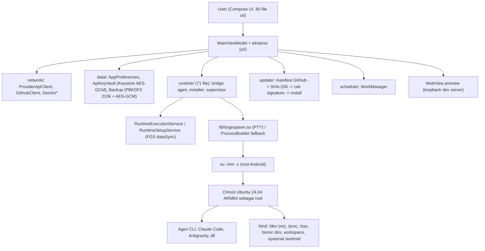
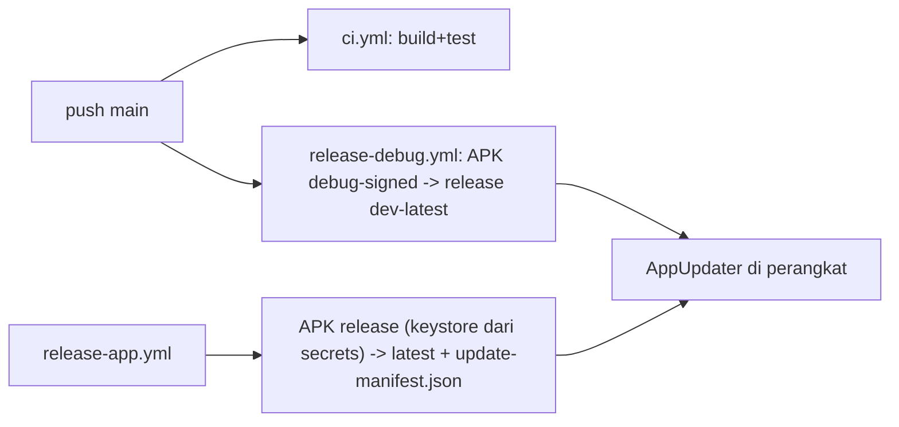

# Audit NextCraft Forge — 2026-10-29 (HEAD f3eb1ed)

Cakupan: manifest, build/CI, runtime chroot, keamanan, update, WebView, UI/a11y, i18n, tes. Hanya yang saya baca/jalankan yang dilaporkan. Tidak diaudit: isi `.so` native, `ForgeMcpServer` Python penuh, 80 file UI satu per satu, perilaku di perangkat nyata.

## 1. Kerangka sistem

## 2. Temuan

| # | Sev | Area | Temuan | Bukti |
|---|-----|------|--------|-------|
| 1 | HIGH | Arsitektur/keamanan | Agen berjalan sebagai root nyata di chroot dengan `/dev` host di-bind **rw**. Root di chroot + akses `/dev/block/*` = bisa baca/tulis partisi mentah; chroot bukan sandbox. Semua guard (`ClaudeToolRisk` denylist path) hanya mitigasi tingkat aplikasi dan bisa dilewati (encoding, glob, subproses). | `runtime/RuntimeSupervisorScripts.kt:191-192` |
| 2 | HIGH | Keamanan | Antigravity dijalankan dengan `--dangerously-skip-permissions` di semua jalur; satu-satunya gerbang adalah sisi aplikasi. | `AntigravityRuntimeSupport.kt:132`, `AntigravityRuntimeBridge.kt:377` |
| 3 | HIGH | Supply chain | Keystore debug publik (password `android`) ditrack di repo dan dipakai untuk APK yang dipublikasikan sebagai release (`dev-latest`) dan dipasang in-place oleh updater (cek signature = sama dengan terpasang). Siapa pun bisa menandatangani APK yang diterima sebagai update build debug, yang punya akses root grant + rootfs. | `app/build.gradle.kts` (`sharedDebug`), `app/debug.keystore` tracked, `AppUpdater.kt:127-135` |
| 4 | MEDIUM | CI | `release-debug.yml`: komentar header bilang hanya publish bila commit berisi `[release]`, tetapi kondisi `if:` meloloskan **setiap push ke main**. Komentar menipu; tiap push mengganti rilis dev-latest. | `.github/workflows/release-debug.yml:29` |
| 5 | MEDIUM | Izin | `QUERY_ALL_PACKAGES`, `REQUEST_INSTALL_PACKAGES`, `RECORD_AUDIO`, `REQUEST_IGNORE_BATTERY_OPTIMIZATIONS` — ditolak kebijakan Play; dapat diterima untuk sideload tapi mengunci distribusi. Terdokumentasi di `docs/PERMISSIONS.md`/lint.xml. | `AndroidManifest.xml` |
| 6 | MEDIUM | Runtime | FGS `dataSync` dibatasi ~6 jam/24 jam (Android 15+). `onTimeout` sudah menangani, tapi setelah itu sesi agen panjang kehilangan perlindungan dari pembunuhan proses di latar belakang. | `RuntimeExecutionService.kt:235` |
| 7 | MEDIUM | Kredensial | Token GitHub ditulis plaintext ke `~/.git-credentials` dan `gh/hosts.yml` di rootfs (0600) — terbaca oleh agen root dan tercakup backup rootfs. Dimitigasi denylist `ClaudeToolRisk`, bukan isolasi. | `RuntimeInstallerAgentsAndStacks.kt:150-182` |
| 8 | MEDIUM | Tes | 87 file tes unit untuk 238 file main; hanya 1 file `androidTest`; UI Compose praktis tak teruji instrumented; jalur `su`/chroot tidak bisa diuji CI. | `find app/src/test`, `app/src/androidTest` |
| 9 | LOW | Dokumen | `.forge/memory.md` menyatakan Theme.kt memakai palet "Instagram Light DM" (#FFFFFF/#F4F5F7/#DBDBDC). Kode sebenarnya tidak: commit `a6df327` mengembalikan surface White asli (#FBFCFE/#F1F3F8/#DDE1EA), hanya teks #0C1014 yang dipertahankan. Catatan basi. | `ui/Theme.kt:347-356`, `git log -S` |
| 10 | LOW | A11y | 15 `contentDescription = null` pada ikon (sebagian dekoratif sah; `AgentScreen.kt:420`, `FilesAndDiffEditor.kt:288` ikon aksi — perlu dicek ada label di parent). | grep `ui/` |
| 11 | LOW | WebView | JS + DOM storage aktif, navigasi http(s) apa pun tetap di dalam WebView (tidak dibatasi ke loopback); file/content access sudah dimatikan, skema non-http diblok. | `WebPreviewScreen.kt:290-305` |
| 12 | LOW | Lint | 55 peringatan, 0 error: `PluralsCandidate` 29, `AutoboxingStateCreation` 12, `ConfigurationScreenWidthHeight` 4, sisanya 1-2. Lint menyembunyikan `OldTargetApi` (targetSdk 36 vs compileSdk 37), `Aligned16KB` (libtermux tidak 16KB-aligned: akan bermasalah di perangkat 16KB page). | `app/lint.xml` |
| 13 | LOW | Maintainability | Python utuh tertanam sebagai string Kotlin (`ForgeMcpServer.kt` 834 baris, skrip supervisor shell di `RuntimeSupervisorScripts.kt`); 5 file Kotlin 920-998 baris, mepet batas 1000. | `wc -l` |
| 14 | INFO | Log | `Log.d("ClaudeBridge", "Launch environment keys: ...")` hanya mencetak nama key, bukan nilai. Aman, tapi sebaiknya dihapus di release. | `ClaudeRuntimeBridge.kt:182` |

## 3. Yang diperiksa dan baik

- Kripto: Keystore AES-GCM (key tak terikat auth, migrasi atomik), backup PBKDF2-HMAC-SHA256 210k iterasi + AES-256-GCM berchunk dengan AAD indeks/last; API key hanya dibackup bila terenkripsi; kunci endpoint tidak dipulihkan dari arsip tak terotentikasi.
- Update: SHA-256 wajib + versionCode + signature cocok dengan app terpasang.
- Jaringan: cleartext hanya loopback; tidak ada TrustManager/HostnameVerifier kustom; SSRF di MCP ditangani (resolve sekali, validasi semua alamat).
- `su -c`: argumen yang diinterpolasi berupa Int atau di-quote (`shellSingleQuote`); `kill` menolak pid <= 1.
- Manifest: `allowBackup=false`, semua service/receiver/provider `exported=false`, FileProvider dibatasi ke 3 subpath.
- CI: semua action dipin ke SHA, `permissions` minimal, CodeQL + gitleaks.
- i18n: 6 locale punya key identik dengan default (0 hilang/0 lebih).
- Tes unit: 385 tes di 89 kelas, 0 gagal, 1 skip (hasil `testDebugUnitTest`, berkas XML 11:37 hari ini).

## 4. Prioritas perbaikan

1. #3: hentikan publikasi APK debug-signed ke kanal yang dibaca updater, atau pakai key debug per-developer; hapus `debug.keystore` dari repo.
2. #4: samakan `if:` dengan komentar (hapus `github.ref_name == 'main'`).
3. #1/#2: jangan bind `/dev` penuh (pakai node whitelist: null, zero, random, urandom, tty, pts, shm); dokumentasikan bahwa chroot bukan batas keamanan.
4. #9: hapus catatan basi di `.forge/memory.md`.
5. #8, #10, #12: tambah tes instrumented UI, label a11y, rapikan lint.
